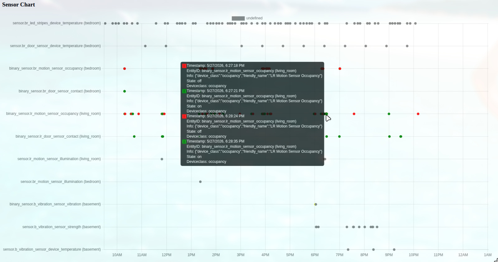
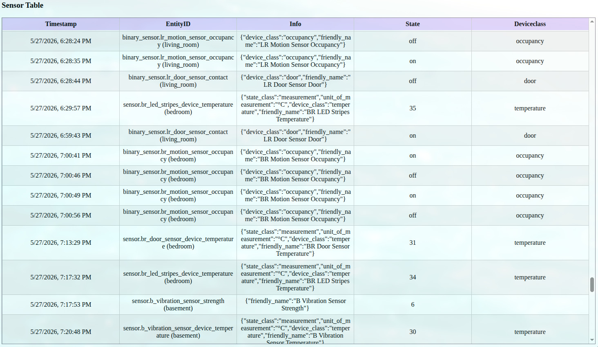
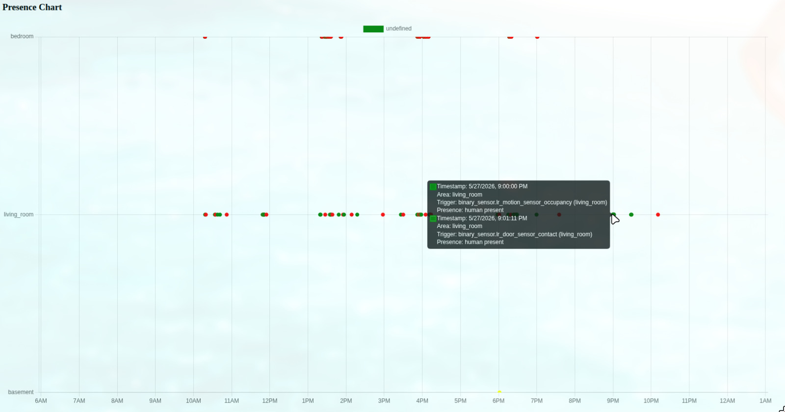
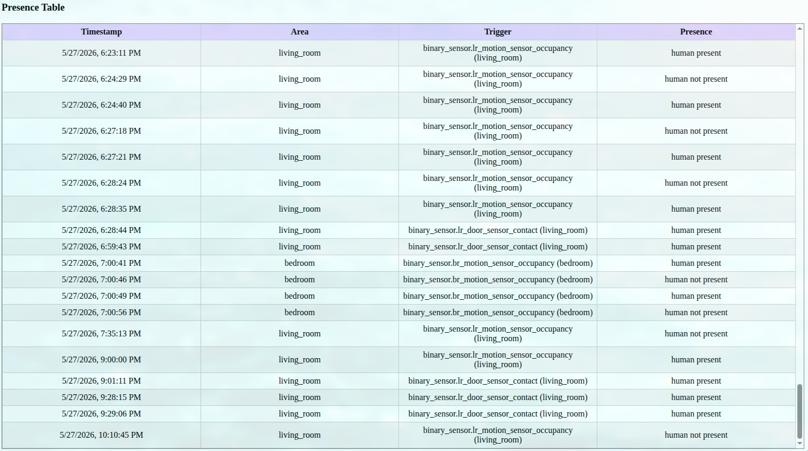

## Setup 
```npm install```

### It might be necessary to enter the Python venv
```source .venv/bin/activate```

## Run 
```npm start```

## If problems occur, try to set up manually 
### Python Backend
```
python -m venv .venv/
source .venv/bin/activate
pip install flask_sqlalchemy
   
```

### Electron Frontend
```
npm install electron
npm install @vscode/sudo-prompt
npm install
```

## Example 



